# taskflow-gitops — dépôt GitOps du cours CI/CD M2

Ce dépôt décrit **l'état voulu** de l'application TaskFlow dans Kubernetes.
Argo CD le surveille et aligne le cluster dessus : pour changer la production,
on ne tape pas de commande, on fait une **Pull Request**.

## Installation (à faire chez vous, avant le cours)

Prérequis : Docker Desktop démarré, 8 Go de RAM, 10 Go de disque libre.
Sous Windows : WSL2 (Ubuntu) + intégration WSL de Docker Desktop, et toutes les commandes dans WSL.

```bash
git clone https://github.com/9m7fjfpv9k-cyber/taskflow-gitops.git
cd taskflow-gitops
./scripts/install.sh
```

Le script crée un cluster local `kind`, installe Argo CD et Argo Rollouts,
puis télécharge les images des labs. Comptez 5 à 15 minutes.
Il peut être relancé sans risque.

## Structure

| Chemin | Rôle |
| --- | --- |
| `apps/taskflow/` | Les manifests surveillés par Argo CD |
| `argocd/application.yaml` | Déclare l'application dans Argo CD |
| `exemples/bluegreen/` | Manifests pour le déploiement Blue-Green |
| `exemples/canary/` | Manifests pour le déploiement Canary |
| `exemples/robustesse/` | Canary avec test de charge k6 automatique, modèle de postmortem |
| `exemples/ci/` | Pipelines de la mini-PSSI (GitHub Actions et GitLab CI) |
| `policies/` | Mini-PSSI et règles Rego vérifiées par conftest |
| `scripts/install.sh` | Installation de l'environnement |
| `scripts/argocd-ui.sh` | Ouvre l'interface d'Argo CD |
| `scripts/observe.sh` | Montre quelle version répond, et avec quel code HTTP |
| `scripts/charge.sh` | Lance à la main le test de charge k6 contre un service |

## Images disponibles

`ghcr.io/9m7fjfpv9k-cyber/taskflow` en versions `1.0.0`, `1.1.0`, `2.0.0`, `2.1.0` et `2.2.0`.

## Équipe

<!-- Noms du binôme -->
- Joseph DELNORD
- Yani SADKI

## Journal du lab — déploiement par PR et retour arrière

### Étape 1 — Fork, binôme et protection de `main`

- **Fork :** réalisé sous `josephDelnord` (remote `origin` du dépôt local).
- **Binôme :** `Yani-sup2vinci` ajouté au dépôt.
- **Ruleset :** `protection-main` est actif et cible une branche. La règle exige
  une Pull Request avec 1 approbation avant fusion.

**Capture — règle « Require a pull request before merging » et 1 approbation :**

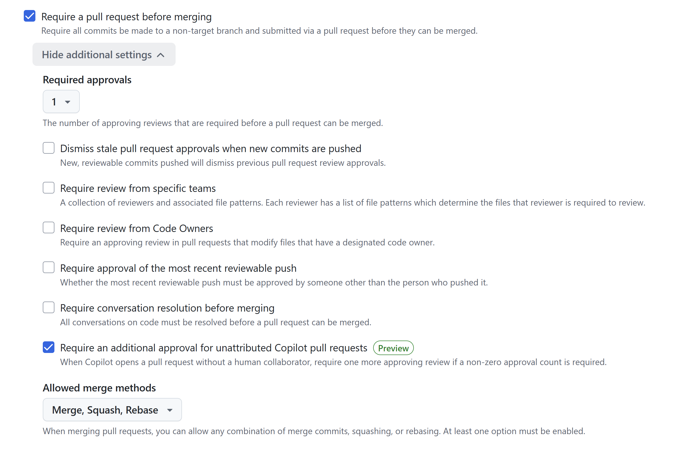

**Capture — ruleset `protection-main` actif :**

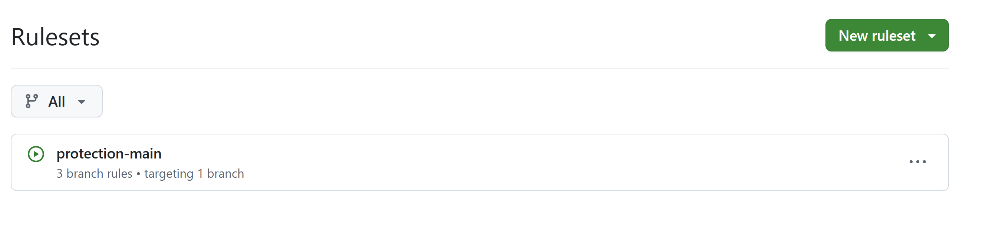

**Ce qui a été fait et pourquoi :** le fork donne à l'équipe son dépôt de travail et
le binôme y a accès. Le ruleset rend obligatoire le passage par une Pull Request
et une approbation avant fusion, afin d'éviter les changements directs non tracés
et d'ajouter une revue par le binôme.

### Étape 2 — Enregistrer l'application dans Argo CD

- **Dépôt surveillé :** `https://github.com/josephDelnord/taskflow-gitops.git`,
  branche `main`, chemin `apps/taskflow`.
- **Contexte vérifié :** `kind-cicd`.
- **Commande exécutée :** `kubectl apply -f argocd/application.yaml`.
- **Résultat :** l'application `taskflow` est `Synced` et `Healthy` à la révision
  `9579861f88c765656599b923e04099574f99a7e5` ; à cette étape, le Deployment
  sert la version initiale `1.0.0` et ses 4 réplicas sont prêts.

**Capture — vérification du contexte Kubernetes :**

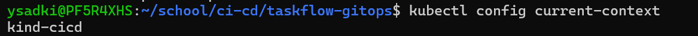

Cette sortie confirme le contexte cible avant toute commande Kubernetes, afin
d'éviter d'appliquer les changements sur un autre cluster.

**Capture — remplacement de l'URL du dépôt modèle par le fork :**

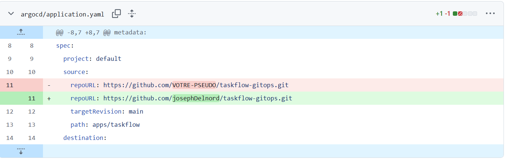

Le diff montre le remplacement de `VOTRE-PSEUDO` par `josephDelnord`, pour que
l'application Argo CD lise les manifests du fork de l'équipe.

**Ce qui a été fait et pourquoi :** le manifeste relie Argo CD au dépôt Git et
à son chemin Kubernetes. L'URL `VOTRE-PSEUDO` a été remplacée par celle du fork
pour qu'Argo CD lise le bon dépôt. Vérifier le contexte avant `kubectl apply`
évite de modifier un mauvais cluster. L'application du manifeste enregistre la
source dans Argo CD ; `Synced` confirme que les ressources correspondent au Git,
et `Healthy` confirme leur bon état dans Kubernetes. À cette étape, le manifeste
initial déployait TaskFlow en `1.0.0`.
L'application du manifeste est une opération de cluster, indépendante de la PR
qui versionne le changement de configuration dans ce dépôt.

### Étape 3 — Vérifier l'état et observer les réponses

- **Argo CD :** `taskflow` est `Synced / Healthy`.
- **Observation :** `./scripts/observe.sh` a compté 40 réponses
  `version=1.0.0 http=200`.

**Capture — état Argo CD et observation de la version initiale :**

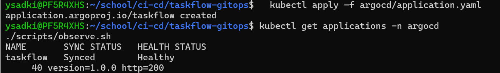

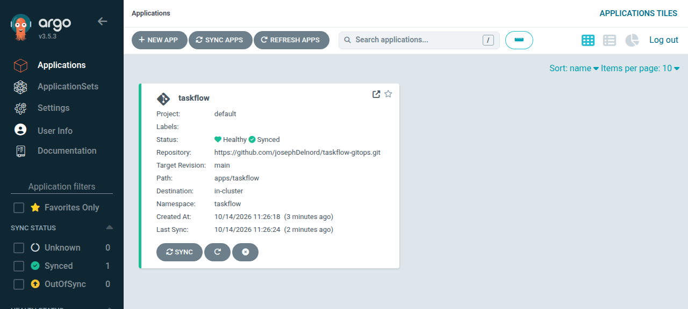

**Ce qui a été fait et pourquoi :** la capture confirme que l'application est
`Synced / Healthy`, puis `./scripts/observe.sh` vérifie le service réellement exposé
en envoyant 40 requêtes. Les réponses `1.0.0` avec HTTP 200 montrent que la version
initiale est disponible et répond correctement.

### Étape 4 — Observer le déploiement après la fusion d'une PR

- **Délai constaté :** environ une minute entre le merge de la PR et le déploiement
  effectif dans le cluster.
- **Séquence observée :** Argo CD détecte l'écart (`OutOfSync`), lance la
  synchronisation automatique (`Synced / Progressing`), puis termine le rollout
  (`Synced / Healthy`).

**Capture — état final dans Argo CD après la synchronisation :**

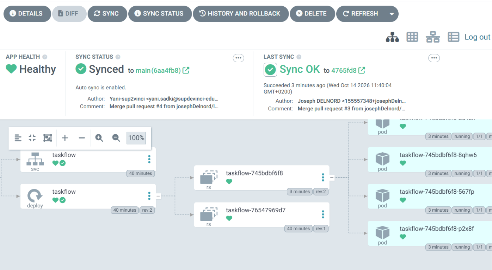

La vue Argo CD confirme que le commit issu de la PR est suivi par `main`, que
l'auto-sync est actif et que l'application est revenue à l'état `Healthy`.

**Capture — états observés pendant le polling et le rollout :**

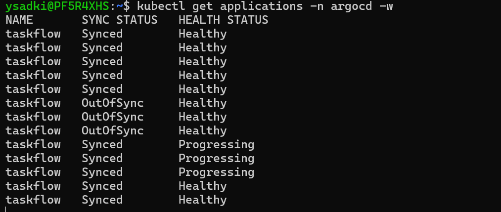

La sortie montre le passage d'`OutOfSync` à `Synced / Progressing`, puis
`Synced / Healthy` lorsque les nouveaux pods sont prêts.

**Ce qui a été fait et pourquoi :** après le merge, Argo CD ne reçoit pas
nécessairement un événement immédiat du dépôt ; il le consulte périodiquement
(polling). Le délai observé d'environ une minute correspond au temps avant la
détection du changement, auquel s'ajoute la durée du rollout. Une fois l'écart
détecté, l'auto-sync réconcilie le cluster avec l'état déclaré dans Git. Observer
les statuts permet de distinguer le délai de détection de la mise à jour effective
des pods.

### Étape 5 — Provoquer une dérive et observer l'auto-réparation

- **Modification manuelle du cluster :** passage temporaire à 5 réplicas et
  changement de l'image vers `1.0.0` avec `kubectl`.
- **Écart détecté :** Argo CD compare l'état réel du cluster à l'état déclaré dans
  Git et marque l'application `OutOfSync`.
- **Résultat :** comme l'auto-sync et le self-heal sont activés, Argo CD rétablit
  l'image et le nombre de réplicas déclarés dans Git.

**Capture — dérive provoquée avec `kubectl` :**

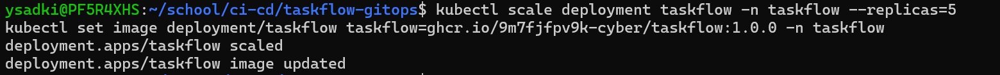

Cette capture montre les deux modifications faites directement sur le cluster,
sans modifier les manifests Git.

**Capture — détection de la dérive par Argo CD :**

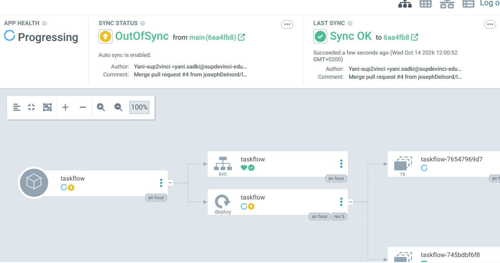

`OutOfSync` indique qu'une ressource du cluster ne correspond plus à la déclaration
Git. `Progressing` montre que la réconciliation et le rollout sont en cours.

**Capture — état déclaré dans Git et replicas après réconciliation :**

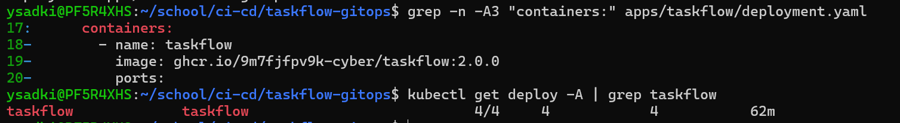

Le manifeste versionné dans Git déclare l'image `2.0.0` ; la capture montre
également le Deployment revenu à 4/4 réplicas.

**Ce qui a été fait et pourquoi :** les commandes `kubectl scale` et `kubectl set
image` simulent une modification hors Git. Argo CD compare en continu l'état du
cluster à la source déclarée. Dès qu'il détecte l'écart, l'auto-sync applique à
nouveau les manifests et le self-heal ramène les ressources à la configuration Git.
Git reste ainsi la source de vérité : la dérive temporaire ne modifie pas le dépôt,
et l'application finit par retrouver l'image et le nombre de réplicas déclarés.
