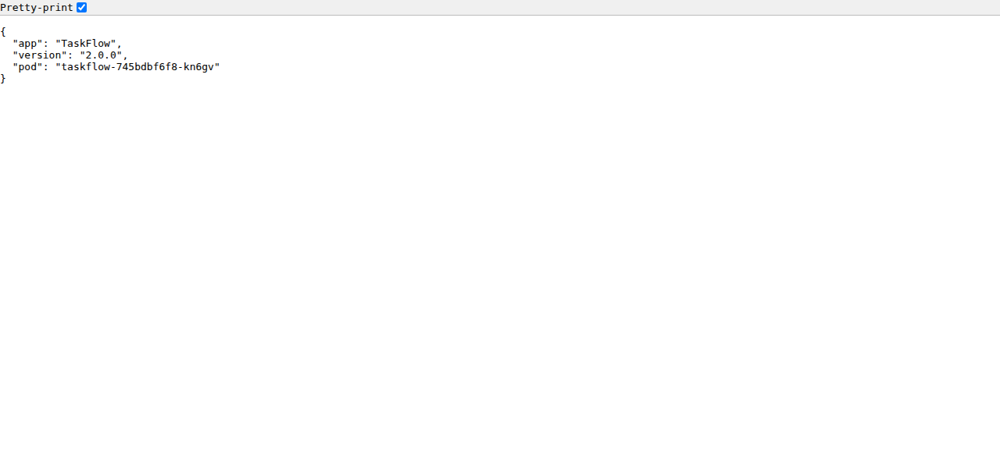

# taskflow-gitops — dépôt GitOps du cours CI/CD M2

Ce dépôt décrit **l'état voulu** de l'application TaskFlow dans Kubernetes.
Argo CD le surveille et aligne le cluster dessus : pour changer la production,
on ne tape pas de commande, on fait une **Pull Request**.

## Installation (à faire chez vous, avant le cours)

Prérequis : Docker Desktop démarré, 8 Go de RAM, 10 Go de disque libre.
Sous Windows : WSL2 (Ubuntu) + intégration WSL de Docker Desktop, et toutes les commandes dans WSL.

```bash
git clone https://github.com/9m7fjfpv9k-cyber/taskflow-gitops.git
cd taskflow-gitops
./scripts/install.sh
```

Le script crée un cluster local `kind`, installe Argo CD et Argo Rollouts,
puis télécharge les images des labs. Comptez 5 à 15 minutes.
Il peut être relancé sans risque.

## Structure

| Chemin | Rôle |
| --- | --- |
| `apps/taskflow/` | Les manifests surveillés par Argo CD |
| `argocd/application.yaml` | Déclare l'application dans Argo CD |
| `exemples/bluegreen/` | Manifests pour le déploiement Blue-Green |
| `exemples/canary/` | Manifests pour le déploiement Canary |
| `exemples/robustesse/` | Canary avec test de charge k6 automatique, modèle de postmortem |
| `exemples/ci/` | Pipelines de la mini-PSSI (GitHub Actions et GitLab CI) |
| `policies/` | Mini-PSSI et règles Rego vérifiées par conftest |
| `scripts/install.sh` | Installation de l'environnement |
| `scripts/argocd-ui.sh` | Ouvre l'interface d'Argo CD |
| `scripts/observe.sh` | Montre quelle version répond, et avec quel code HTTP |
| `scripts/charge.sh` | Lance à la main le test de charge k6 contre un service |

## Images disponibles

`ghcr.io/9m7fjfpv9k-cyber/taskflow` en versions `1.0.0`, `1.1.0`, `2.0.0`, `2.1.0` et `2.2.0`.

## Équipe

<!-- Noms du binôme -->
- Joseph DELNORD
- Yani SADKI

## Journal du lab — déploiement par PR et retour arrière

### Étape 1 — Fork, binôme et protection de `main`

- **Fork :** réalisé sous `josephDelnord` (remote `origin` du dépôt local).
- **Binôme :** `Yani-sup2vinci` ajouté au dépôt.
- **Ruleset :** `protection-main` est actif et cible une branche. La règle exige
  une Pull Request avec 1 approbation avant fusion.

**Capture — règle « Require a pull request before merging » et 1 approbation :**


**Capture — ruleset `protection-main` actif :**


**Ce qui a été fait et pourquoi :** le fork donne à l'équipe son dépôt de travail et
le binôme y a accès. Le ruleset rend obligatoire le passage par une Pull Request
et une approbation avant fusion, afin d'éviter les changements directs non tracés
et d'ajouter une revue par le binôme.

### Étape 2 — Enregistrer l'application dans Argo CD

- **Dépôt surveillé :** `https://github.com/josephDelnord/taskflow-gitops.git`,
  branche `main`, chemin `apps/taskflow`.
- **Contexte vérifié :** `kind-cicd`.
- **Commande exécutée :** `kubectl apply -f argocd/application.yaml`.
- **Résultat :** l'application `taskflow` est `Synced` et `Healthy` à la révision
  `9579861f88c765656599b923e04099574f99a7e5` ; le Deployment a ses 4 réplicas prêts.


**Capture — vérification du contexte Kubernetes :**


Cette sortie confirme le contexte cible avant toute commande Kubernetes, afin
d'éviter d'appliquer les changements sur un autre cluster.

**Capture — remplacement de l'URL du dépôt modèle par le fork :**


Le diff montre le remplacement de `VOTRE-PSEUDO` par `josephDelnord`, pour que
l'application Argo CD lise les manifests du fork de l'équipe.

**Capture — application, santé Argo CD et observation HTTP :**


Cette preuve regroupe la création de l'Application, son état `Synced / Healthy`
et 40 réponses `HTTP 200` de la version `1.0.0` ; elle vérifie que l'application
est déclarée dans Argo CD et qu'elle répond effectivement.

**Ce qui a été fait et pourquoi :** le manifeste relie Argo CD au dépôt Git et
à son chemin Kubernetes. L'URL `VOTRE-PSEUDO` a été remplacée par celle du fork
pour qu'Argo CD lise le bon dépôt. Vérifier le contexte avant `kubectl apply`
évite de modifier un mauvais cluster. L'application du manifeste enregistre la
source dans Argo CD ; `Synced` confirme que les ressources correspondent au Git,
et `Healthy` confirme leur bon état dans Kubernetes. Enfin, `./scripts/observe.sh`
montre que le service répond effectivement en version `1.0.0` avec HTTP 200.
L'application du manifeste est une opération de cluster, indépendante de la PR
qui versionne le changement de configuration dans ce dépôt.

### Étape 3 — Vérifier l'état et observer les réponses

- **Argo CD :** `taskflow` est `Synced / Healthy`.
- **Observation :** `./scripts/observe.sh` a compté 40 réponses
  `version=2.0.0 http=200`.
- **Version attendue :** le manifeste Git déclare `ghcr.io/9m7fjfpv9k-cyber/taskflow:2.0.0`.



**Ce qui a été fait et pourquoi :** l'état `Synced / Healthy` confirme qu'Argo CD
a appliqué les ressources et que le déploiement est sain. Le script envoie ensuite
40 requêtes depuis le cluster pour vérifier le service réellement exposé, la version
qui répond et le code HTTP. Les 40 réponses en `2.0.0` avec HTTP 200 correspondent
à l'image déclarée dans Git ; la capture montre une réponse directe du service avec
sa version et le pod qui l'a servie.
